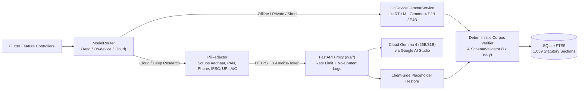

# Lex — Offline-Capable AI Legal Copilot (India)

[](LICENSE)
[](https://github.com/SriRamKunamsetty/lex-ai-legal-copilot/actions/workflows/ci.yml)
[](pubspec.yaml)
[](backend/requirements.txt)
[](lib/l10n/)

**Lex** is an open-source, privacy-first, offline-capable AI legal copilot mobile app (**Flutter** for Android & iOS) with an optional lightweight **FastAPI** AI proxy backend, designed for **individuals, MSMEs, and legal practitioners in India**.

It combines **on-device Gemma 4** inference (`LiteRT-LM` via `flutter_edge_ai`), a bundled **1,059-section offline Indian statutory corpus** (**BNS, BNSS, BSA 2023**), deterministic citation verification, pre-flight PII redaction, and an encrypted local vault inside an adaptive liquid-glass UI.

> **Important Legal Notice**  
> Lex is an informational legal research and productivity tool. Every AI response is paired with a confidence tier and a *"Verify with official statutory text — not legal advice"* disclaimer. Lex does **not** provide formal legal advice or replace a qualified advocate.

---

## Table of Contents

- [Why Lex?](#why-lex)
- [Core Features](#core-features)
- [Hybrid AI & Verification Architecture](#hybrid-ai--verification-architecture)
- [Offline Indian Statutory Corpus](#offline-indian-statutory-corpus)
- [Security & Privacy Model](#security--privacy-model)
- [Tech Stack](#tech-stack)
- [Repository Structure](#repository-structure)
- [Getting Started](#getting-started)
  - [Prerequisites](#prerequisites)
  - [1. Clone & Bootstrap Flutter App](#1-clone--bootstrap-flutter-app)
  - [2. Run the FastAPI Backend (Optional Cloud Proxy)](#2-run-the-fastapi-backend-optional-cloud-proxy)
  - [3. Regenerate the Legal Corpus (Optional)](#3-regenerate-the-legal-corpus-optional)
- [Build Flavors, Android Signing & iOS Notes](#build-flavors-android-signing--ios-notes)
- [Testing, Evaluation Harness & CI](#testing-evaluation-harness--ci)
- [Design System & Localization](#design-system--localization)
- [Known Verification Gaps (`TODO(verify)`)](#known-verification-gaps-todoverify)
- [Contributing & Community](#contributing--community)
- [License](#license)

---

## Why Lex?

1. **Post-2024 Indian Criminal Law Grounding**: General LLMs frequently confuse repealed IPC/CrPC/IEA sections with India's **Bharatiya Nyaya Sanhita (BNS), Bharatiya Nagarik Suraksha Sanhita (BNSS), and Bharatiya Sakshya Adhiniyam (BSA), 2023**. Lex bundles verbatim statutory sections offline in SQLite FTS5 and runs a deterministic verifier pass so unverified citations are flagged or stripped.
2. **Offline-First & Private by Default**: Statutory lookups, section reading, FTS5 search, case management, and **Gemma 4 E2B / E4B** inference (`LiteRT-LM`) work without internet connectivity.
3. **Zero Plaintext Cloud PII Leakage**: Whenever cloud routing is enabled, deterministic pre-flight redaction (`PiiRedactor`) replaces Aadhaar, PAN, phone numbers, IFSC, UPI IDs, emails, and bank account numbers locally before calling the FastAPI proxy, and restores placeholders client-side after streaming completes.

---

## Core Features

| Module | Route / File | Capabilities |
|---|---|---|
| **Onboarding** | `/onboarding` (`lib/features/onboarding/`) | 3-step setup covering trust principles, user role (`Individual`, `Business`, `Lawyer`), and AI privacy routing (`Auto`, `On-device`, `Cloud`). |
| **Customizable Home Desk** | `/home` (`lib/features/home/`) | Greeting header, toggleable & reorderable cards (`Scan CTA`, `Ask Bar`, `Quick Actions`, `Risk Radar`, `Deadlines`, `Recent`), live theme/accent parity. |
| **Scan → Chat** | `/scan` (`lib/features/scan/`) | Multi-page ML Kit document edge-detection/crop (`google_mlkit_document_scanner`), camera/gallery import, on-device OCR (`google_mlkit_text_recognition`) with automatic multimodal Gemma fallback on low OCR confidence, structured JSON extraction (type, parties, dates, deadlines, amounts, risks), optional `LEX1` encrypted scan storage, and one-tap handoff to grounded chat. |
| **Ask Lex (Chat)** | `/ask` (`lib/features/chat/`) | Streaming legal Q&A with attached document context, deterministic corpus verification, tappable verified `CitationChip`s → Section Reader, `ConfidenceBadge`, **Reasoning trail** and **Counter-arguments** toggles, prompt preservation & retry on failure. |
| **Incident → Sections** | `/incident` (`lib/features/incident/`) | 6 preset categories (`Theft`, `Accident`, `Cheque bounce`, `Cyber fraud`, `Tenancy`, `Workplace`) + text, voice dictation (`speech_to_text`), and photo input → corpus-verified `BNS`/`BNSS`/`BSA` sections, actionable **Next Steps**, and **Evidence** checklist. |
| **Offline Section Reader** | `/section/:act/:number` (`lib/features/section_reader/`) | Full statutory text, plain-language summary, chapter metadata, official source link, legacy IPC/CrPC/IEA cross-reference badges (where verified), bookmarking, sharing, and *"Ask Lex about this section"*. |
| **Contract Review** | `/contract-review` (`lib/features/contract_review/`) | Paste or load contract text → clause segmentation, `0–100` risk `ScoreRing`, High/Medium/Low clause flags with rationales, side-by-side redline preview, one-tap **Apply safer wording**, and shareable amended text. |
| **Legal Drafting & PDF** | `/draft` (`lib/features/draft/`) | 5 Indian legal templates (`Rent agreement`, `NDA`, `Legal notice`, `Affidavit`, `Employment offer`), prefill from saved scans, explicit `[Placeholder]` tracking, mandatory-clause self-check, A4 PDF export/print (`pdf` + `printing`), and mandatory `LAWYER REVIEW NOTICE`. |
| **Case File & Reminders** | `/case-file` (`lib/features/case_file/`) | Encrypted matter workspace per dispute (`CaseFiles`, `CaseDeadlines`, `CaseChecklistItems`), timeline links to scans/drafts, local OS deadline notifications (`flutter_local_notifications`), and shareable case summary. |
| **Find Legal Help** | `/legal-help` (`lib/features/legal_aid/`) | Interactive `FlutterMap` + `Geolocator` proximity sorting across **Legal Aid**, **Lawyers**, and **Police** tabs with a pluggable `LegalHelpDirectorySource` and one-tap **Share case summary**. Ships with explicitly labelled placeholder data (`isPlaceholder: true`) — never fabricated individuals or real numbers. |
| **Library** | `/library` (`lib/features/library/`) | Encrypted full-text search across Bookmarks, Saved Scans, Saved Drafts, and Chat History. |
| **Appearance & AI Privacy** | `/customize`, `/customize/appearance`, `/customize/ai-privacy` (`lib/features/settings/`) | Live runtime customization: Light/Dark/System theme, 5 accent presets (`Indigo`, `Teal`, `Terracotta`, `Violet`, `Rose`), corner roundness, liquid-glass blur intensity, font family (`System`, `Serif`, `Mono`), text scale, compact density, Home widget toggles/reordering, AI verbosity & citation strictness, model routing, `en`/`hi`/`te` localization, Gemma 4 model download/delete, biometric lock, local encryption toggle, scan retention days, JSON data export, and full data wipe. |

---

## Hybrid AI & Verification Architecture

All AI pipelines depend on a single abstraction, `abstract interface class LlmService` (`lib/ai/llm_service.dart`), exposing `chat(...)`, `structured(...)`, `describeImage(...)`, and capability flags (`supportsImages`, `supportsAudio`, `isOnDevice`).



### Hybrid Routing & Model Management

- **`OnDeviceGemmaService`** (`lib/ai/on_device/on_device_gemma_service.dart`): Runs Google **Gemma 4 E2B** (`gemma-4-e2b-it`) and **Gemma 4 E4B** (`gemma-4-e4b-it`) `.litertlm` packages locally via `flutter_edge_ai` + `flutter_edge_ai_litertlm`, with SHA-256 download verification, progress tracking, model deletion, and low-memory fallback (`E4B -> E2B` / `GPU -> CPU`).
- **`CloudGemmaService`** (`lib/ai/cloud/cloud_gemma_service.dart`): Connects via `LexHttpClient` (`dio`) to the FastAPI proxy (`POST /v1/chat` SSE and structured endpoints).
- **`ModelRouter`** (`lib/ai/router/model_router.dart`): Honors user preference (`Auto`, `On-device`, `Cloud`). In `Auto`, private/offline/short queries stay on device while deep tasks can escalate to cloud (falling back gracefully to on-device if cloud fails).

### Tested AI Pipelines

All prompt templates and JSON schemas live in versioned asset files (`assets/ai/prompts/*_v1.txt` and `assets/ai/schemas/*.schema.json`) rather than inline strings:

| Pipeline | Location | Guardrails |
|---|---|---|
| `DocumentPipeline` | `lib/ai/pipelines/document_pipeline.dart` | Multi-page ML Kit OCR → confidence check → multimodal vision fallback when OCR confidence is low → JSON extraction (`SchemaValidator` with 1x retry). |
| `ResearchPipeline` | `lib/ai/pipelines/research_pipeline.dart` | Query rewrite → FTS5 & citation retrieval → low-temperature grounded answer → **Deterministic Corpus Verifier** (verifies every `BNS`/`BNSS`/`BSA` section against SQLite; strips unverified references when `strictCitationsOnly` is enabled). |
| `IncidentPipeline` | `lib/ai/pipelines/incident_pipeline.dart` | Category expansion + FTS5 candidate retrieval (`BNSS 173` baseline) → structured section selection → verified sections only + offline deterministic fallback. |
| `ContractPipeline` | `lib/ai/pipelines/contract_pipeline.dart` | Clause segmentation → per-clause severity (`high`/`medium`/`low`), rationale, suggested rewrite, `0–100` score + offline keyword heuristic fallback. |
| `DraftPipeline` | `lib/ai/pipelines/draft_pipeline.dart` | 5 templates + optional scan entity prefill → explicit `[Placeholder]` markers → mandatory-clause check → mandatory `LAWYER REVIEW NOTICE`. |

---

## Offline Indian Statutory Corpus

Lex ships a bundled statutory dataset in [`assets/corpus/indian_law_corpus_v1.json`](assets/corpus/indian_law_corpus_v1.json) parsed from official Gazette of India Act PDFs (PRS India Gazette mirror) via [`scripts/ingest_legal_corpus.py`](scripts/ingest_legal_corpus.py), indexed into SQLite FTS5 (`LegalCorpusRepository`):

| Act Code | Official Title | Sections Indexed |
|---|---|---|
| `BNS` | Bharatiya Nyaya Sanhita, 2023 (Act No. 45 of 2023) | **358** |
| `BNSS` | Bharatiya Nagarik Suraksha Sanhita, 2023 (Act No. 46 of 2023) | **531** |
| `BSA` | Bharatiya Sakshya Adhiniyam, 2023 (Act No. 47 of 2023) | **170** |
| **Total** | | **1,059** |

Seeded anchor examples (such as `BNS 303` Theft, `BNS 304` Snatching, `BNS 309` Robbery, `BNSS 173` FIR, `BSA 63`) include verified legacy cross-references (`IPC`/`CrPC`/`IEA`) with explicit `TODO(verify)` markers where full official concordance ingestion is still pending.

---

## Security & Privacy Model

See [`docs/threat-model.md`](docs/threat-model.md) for full details. Key controls implemented in the codebase:

| Asset / Risk | Control Implemented |
|---|---|
| Local SQLite Vault (`AppDatabase` v2) | Encrypted via `sqlite3mc` (`PRAGMA key`) with a 256-bit key stored in OS Keystore / Keychain using `flutter_secure_storage` (`SecureKeyManager`). |
| Scanned Document Files | `EncryptedFileStore` (`lib/core/security/encrypted_file_store.dart`) encrypts local scans into `LEX1` blobs (16-byte CSPRNG nonce + SHA-256 CTR stream + HMAC-SHA256 integrity tag) when `encryptLocalFiles` is enabled. |
| Cloud Inference PII | `PiiRedactor` (`lib/ai/redaction/pii_redactor.dart`) scrubs Aadhaar, PAN, `+91` phone numbers, emails, IFSC, UPI handles, account numbers, and explicit party names pre-flight, restoring locally after response. |
| Screen & Access Privacy | `BiometricLockGate` (`local_auth`) + Android `FLAG_SECURE` in `MainActivity.kt` preventing OS task-switcher previews and screenshots when enabled. |
| Data Retention & Erasure | Startup purge of expired scans (`autoDeleteScansDays`, default `30`), full JSON data export, and one-tap **Delete all data** wipe in AI & Privacy settings. |
| Backend Proxy Auth & Logging | Short-lived HMAC-signed device tokens (`POST /v1/auth/device-token`), sliding-window per-device rate limiting (`30 req/min` default), server-only `LEX_GEMINI_API_KEY`, and no-content request metadata logging. |

---

## Tech Stack

### Flutter Mobile Client (`pubspec.yaml`)
- **Framework**: Flutter (Stable) & Dart `^3.13.5` (null safety, sealed classes, records, pattern matching)
- **State & DI**: `flutter_riverpod` (`^3.5.0`) + `riverpod_annotation` / `riverpod_generator`
- **Navigation**: `go_router` (`^18.1.4`) + `go_router_builder` typed routes & `StatefulShellRoute`
- **Models & Functional Errors**: `freezed` / `json_serializable` + custom sealed `Result<T>` / `Failure` hierarchy
- **Persistence & Encryption**: `drift` (`^2.35.4`) + `sqlite3` (`^3.9.2` with `sqlite3mc` hook), `flutter_secure_storage` (`^11.2.0`), `crypto` (`^3.0.8`), `shared_preferences`
- **On-Device & Cloud AI**: `flutter_edge_ai` (`^2.7.2`), `flutter_edge_ai_litertlm` (`^1.21.3`), `dio` (`^5.11.1`)
- **Device & Document Capabilities**: `google_mlkit_document_scanner`, `google_mlkit_text_recognition`, `image_picker`, `speech_to_text`, `local_auth`, `flutter_local_notifications`, `pdf`, `printing`, `share_plus`, `flutter_map` + `latlong2`, `geolocator`, `url_launcher`
- **Quality & Lints**: `very_good_analysis` (`^11.0.0`), `flutter_localizations` + `intl` (`en`, `hi`, `te`)

### Backend Proxy (`backend/requirements.txt`)
- **Framework**: FastAPI (`>=0.115.0`), Uvicorn, Pydantic v2 & `pydantic-settings`, `httpx`, `pytest` + `pytest-asyncio`
- **Endpoints**:
  - `GET /health`
  - `POST /v1/auth/device-token`
  - `POST /v1/chat` (SSE streaming)
  - `POST /v1/incident/sections`
  - `POST /v1/contract/review`
  - `POST /v1/draft`
  - `POST /v1/document/analyze`
  - `GET /v1/sections/{act}/{number}`

---

## Repository Structure

```text
.
├── .github/workflows/ci.yml        # GitHub Actions: codegen, format, analyze, flutter test, dev APK build
├── assets/
│   ├── ai/
│   │   ├── prompts/                # Versioned *_v1.txt system & pipeline prompts
│   │   └── schemas/                # JSON schemas validated by SchemaValidator
│   └── corpus/
│       └── indian_law_corpus_v1.json  # Bundled 1,059-section BNS/BNSS/BSA 2023 corpus
├── backend/
│   ├── Dockerfile                  # Python 3.12-slim container (build from repo root)
│   ├── requirements.txt
│   ├── app/                        # FastAPI proxy, HMAC auth, rate limiter, corpus store, Gemma client
│   └── tests/test_api.py           # Pytest API & auth/rate-limit unit tests
├── docs/                           # Architecture, AI workflows, threat model, demo script, pitch, sample outputs
├── lib/
│   ├── ai/                         # LlmService, OnDeviceGemmaService, CloudGemmaService, ModelRouter, PiiRedactor, 5 pipelines
│   ├── app/                        # bootstrap, flavors, typed GoRouter, LexTokens & LexTheme
│   ├── core/                       # Result/Failure, encrypted AppDatabase, security store, HTTP client, 16 UI widgets
│   ├── features/                   # onboarding, home, scan, chat, incident, section_reader, contract_review, draft, case_file, legal_aid, library, settings
│   ├── l10n/                       # app_en.arb, app_hi.arb, app_te.arb + generated AppLocalizations
│   ├── legal_corpus/               # Corpus Drift models, FTS5 repository, Riverpod providers
│   └── main_{dev,staging,prod}.dart
├── scripts/
│   └── ingest_legal_corpus.py      # Gazette Act PDF parser & corpus JSON generator
├── test/                           # unit/, widget/, golden/, integration/, eval/ harness
├── CONTRIBUTING.md
├── CODE_OF_CONDUCT.md
├── LICENSE                         # MIT License
└── README.md
```

---

## Getting Started

### Prerequisites

- **Flutter** (stable channel; project tested on Dart SDK `^3.13.5`)
- **Android SDK / Studio** (Android builds use `compileSdk = 37`, `targetSdk = 37`; first build compiles `sqlite3mc` C sources) or **Xcode** on macOS (for iOS)
- **Python 3.12+** (for the optional FastAPI backend and corpus script)

### 1. Clone & Bootstrap Flutter App

```bash
git clone https://github.com/SriRamKunamsetty/lex-ai-legal-copilot.git
cd lex-ai-legal-copilot

# Install Flutter packages and generate l10n + Freezed/Drift/Riverpod/GoRouter files
flutter pub get
flutter gen-l10n
dart run build_runner build --delete-conflicting-outputs

# Run on a connected Android emulator or device (works offline in dev flavor)
flutter run --flavor dev -t lib/main_dev.dart
```

> **Tip**: In the Android emulator, `dev` points `apiBaseUrl` to `http://10.0.2.2:8000` (see [`lib/app/flavors.dart`](lib/app/flavors.dart)). Offline statutory lookups, case files, drafting, and local fallbacks work out of the box even without the backend running.

### 2. Run the FastAPI Backend (Optional Cloud Proxy)

Create a local environment file (never commit `.env`!) or export variables with the `LEX_` prefix defined in [`backend/app/config.py`](backend/app/config.py):

```bash
cd backend
python -m venv .venv
# Activate venv, then:
pip install -r requirements.txt

# Required environment variables (example for local dev)
export LEX_GEMINI_API_KEY="your-server-side-google-ai-studio-key"
export LEX_DEVICE_TOKEN_SECRET="replace-with-strong-random-secret"
export LEX_GEMMA_MODEL="gemma-4-31b-it"

uvicorn app.main:app --host 0.0.0.0 --port 8000 --reload
```

Or run via Docker from the **repository root** (required because `backend/Dockerfile` copies both `backend/` and `assets/corpus/`):

```bash
docker build -t lex-backend -f backend/Dockerfile .
docker run -p 8000:8000 \
  -e LEX_DEVICE_TOKEN_SECRET=replace-with-strong-random-secret \
  -e LEX_GEMINI_API_KEY=your-server-side-key \
  lex-backend
```

Interactive OpenAPI docs are available at `http://localhost:8000/docs`.

### 3. Regenerate the Legal Corpus (Optional)

```bash
pip install pymupdf requests
python scripts/ingest_legal_corpus.py
```

---

## Build Flavors, Android Signing & iOS Notes

- **Flavors**:
  - **Dev**: `flutter run --flavor dev -t lib/main_dev.dart`
  - **Staging**: `flutter run --flavor staging -t lib/main_staging.dart`
  - **Production**: `flutter run --flavor prod -t lib/main_prod.dart --dart-define=LEX_API_BASE_URL=https://api.example.com`
- **Android Release Signing**:
  1. Generate an upload keystore outside git (`keytool -genkey -v -keystore lex-release.jks ...`).
  2. Configure `android/key.properties` (`storePassword`, `keyPassword`, `keyAlias`, `storeFile`) — already excluded by `.gitignore` — and wire `signingConfigs.release` in `android/app/build.gradle.kts`.
  3. Build the release App Bundle: `flutter build appbundle --flavor prod -t lib/main_prod.dart`.
- **iOS Build Notes**:
  1. Privacy permission descriptions (`NSCameraUsageDescription`, `NSPhotoLibraryUsageDescription`, `NSMicrophoneUsageDescription`, `NSSpeechRecognitionUsageDescription`, `NSLocationWhenInUseUsageDescription`, `NSFaceIDUsageDescription`) are configured in [`ios/Runner/Info.plist`](ios/Runner/Info.plist).
  2. Open `ios/Runner.xcworkspace` in Xcode on macOS to configure signing & Team ID, then build with `flutter build ipa --flavor prod -t lib/main_prod.dart`.

---

## Testing, Evaluation Harness & CI

Run the full quality gate locally:

```bash
# Formatting & strict static analysis (`very_good_analysis`)
dart format --output=none --set-exit-if-changed lib test
flutter analyze --fatal-infos

# Full Flutter suite: unit, widget, golden, end-to-end integration, and AI eval harness
flutter test

# FastAPI backend tests
python -m pytest backend/tests/test_api.py -v
```

What is covered:
- **Unit Tests** (`test/unit/`): `Result`/`Failure`, `SecureKeyManager`, `EncryptedFileStore`, `AppDatabase` SQLCipher encryption, `ModelRouter`, `PiiRedactor`, `SchemaValidator`, `OnDeviceGemmaService` (checksum failure, OOM fallback, download progress), `LegalCorpusRepository` FTS5 search, and all 5 AI pipelines.
- **Widget, Golden & Integration Tests** (`test/widget/`, `test/golden/`, `test/integration/`): Full 4-tab shell navigation, scan -> chat -> draft -> PDF flow, contract redline apply, case deadlines, placeholder legal directory, and light/dark `LexTokens` golden snapshots.
- **AI Evaluation Harness** (`test/eval/ai_eval_harness_test.dart`): Measures corpus retrieval accuracy, deterministic citation-verifier hallucination drop behavior, and offline fallback coverage.
- **CI** ([`.github/workflows/ci.yml`](.github/workflows/ci.yml)): Runs `pub get`, `build_runner`, `dart format`, `flutter analyze --fatal-infos`, `flutter test`, and a `dev` debug APK build on pushes/PRs to `main` and `develop`.

---

## Design System & Localization

- **Liquid Glass Design Tokens** (`lib/app/theme/lex_tokens.dart` & `lex_theme.dart`): Built on `ThemeExtension<LexTokens>` so theme mode, accent palette, corner radius, `BackdropFilter` blur intensity, font family, text scale, and density update live across the entire app without restarting.
- **Reusable Component Library** (`lib/core/widgets/`): `LexScaffold`, `GlassBar`, `GlassCard`, `LexCard`, `LexChip`, `LexNavBar`, `LexToggle`, `SegmentedControl`, `RiskPill`, `ConfidenceBadge`, `CitationChip`, `ScoreRing`, `SectionTile`, `ChatBubble`, `DocumentThumb`, and `EmptyState`/`ErrorState` views.
- **Localization** (`lib/l10n/`): ARB resource files for **English (`en`)**, **Hindi (`hi`)**, and **Telugu (`te`)**.

---

## Known Verification Gaps (`TODO(verify)`)

In keeping with strict engineering & legal accuracy, unverified external dependencies are tracked explicitly in code with `TODO(verify)`:

1. **Additional Acts & Full Legacy Concordance** (`scripts/ingest_legal_corpus.py`): `indiacode.nic.in` timed out from the initial build environment, so Negotiable Instruments Act 1881, Information Technology Act 2000, and the full BPR&D legacy IPC/CrPC/IEA concordance table await rerun from an unrestricted network.
2. **Production TLS Certificate Pinning** (`lib/core/network/lex_http_client.dart` & `lib/app/flavors.dart`): Production API domain URLs and TLS SPKI pin hashes carry `TODO(verify)` until production hosting is provisioned.
3. **Physical Hardware Checks**: Physical camera ML Kit document scanning, multi-GB Gemma 4 `.litertlm` weight downloads, biometric hardware prompts, and iOS background task-switcher snapshot blurring require verification on physical Android/iOS hardware.
4. **Hosted Model ID & Multilingual PII** (`docs/ai-workflows.md`, `docs/threat-model.md`): Exact Vertex AI / Google AI Studio Gemma 4 endpoint IDs for `prod` deployments and transliterated Hindi/Telugu PII edge cases carry `TODO(verify)`.

---

## Additional Documentation

- [Architecture Overview](docs/architecture.md)
- [AI & Verification Workflows](docs/ai-workflows.md)
- [Threat Model & Security Controls](docs/threat-model.md)
- [3-Minute Demo Script](docs/demo-script.md)
- [Pitch Outline](docs/pitch-outline.md)
- [Sample AI Outputs](docs/sample-outputs/)

---

## Contributing & Community

Contributions are welcome! Please read the [Contributing Guide](CONTRIBUTING.md) and abide by our [Code of Conduct](CODE_OF_CONDUCT.md).

- **Bug reports & feature ideas**: Open an issue on GitHub.
- **Security or privacy vulnerabilities**: Do **not** file a public issue — email **mohansriramkunamsetty@gmail.com** directly.

---

## License

Lex is open-source software licensed under the [MIT License](LICENSE).
